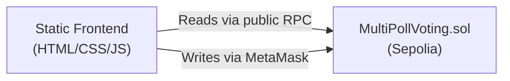

# VOICE

A simple multi-poll voting dApp where polls and votes live on the Ethereum Sepolia testnet.

## Live Demo

Live demo: [https://voice-voting-dapp.vercel.app](https://voice-voting-dapp.vercel.app)

## Screenshots

Screenshots are saved in `docs/screenshots/`:

- `docs/screenshots/home.png` - Home page and trending polls
- `docs/screenshots/polls.png` - Poll list with filter and search
- `docs/screenshots/poll-detail.png` - Single poll page with voting options and tallies
- `docs/screenshots/create.png` - Create poll form
- `docs/screenshots/dashboard.png` - User dashboard with personal voting history

## Features

- Create polls with 2 to 20 options and a custom duration (up to 30 days).
- Optional blind voting mode where results stay hidden until the poll ends.
- One vote per wallet address per poll.
- Poll creators can end active polls early or cancel them.
- Soft-delete (archive) flag so creators can hide ended or cancelled polls from the main list.
- User dashboard showing polls you created, polls you voted on, and archive controls.
- Client-side participation XP and level badges calculated from wallet activity.
- Verify page to look up vote transactions and events by tx hash.
- Dark and light theme toggle with local storage persistence.

## How It Works

There is no custom backend server or database. The `MultiPollVoting` contract deployed on Ethereum Sepolia stores all poll data, options, and vote counts.

- **Reads:** The frontend reads poll data and tallies directly from Sepolia using public RPC endpoints through ethers.js v6. Visitors do not need to connect a wallet just to view polls.
- **Writes:** Creating a poll, voting, ending a poll early, cancelling, or archiving sends a transaction through MetaMask (or any injected EIP-1193 wallet).



## Smart Contract

- **Contract:** `MultiPollVoting.sol`
- **Network:** Ethereum Sepolia (Chain ID: 11155111)
- **Address:** [`0x65259cB1AA56eE2145DdB5B7629Aec4C053690A0`](https://sepolia.etherscan.io/address/0x65259cB1AA56eE2145DdB5B7629Aec4C053690A0#code)
- **Etherscan:** [View verified source on Sepolia Etherscan](https://sepolia.etherscan.io/address/0x65259cB1AA56eE2145DdB5B7629Aec4C053690A0#code)

## Run Locally

### Prerequisites
- Node.js (v18 or higher)
- MetaMask browser extension set to Sepolia testnet
- Sepolia testnet ETH for gas (from any public Sepolia faucet)

### Steps
1. Clone the repo:
   ```bash
   git clone https://github.com/Legit057/Voice-voting-dapp.git
   cd Voice-voting-dapp
   npm install
   ```
2. Run Hardhat tests:
   ```bash
   npx hardhat test
   ```
3. Start a local static server for the frontend:
   ```bash
   npx serve frontend -l 3000
   ```
4. Open [http://localhost:3000](http://localhost:3000) in your browser.

## Deploy the Contract

If you want to deploy your own instance of the contract:

1. Copy `.env.example` to `.env`:
   ```bash
   cp .env.example .env
   ```
2. Fill in `.env` with your Sepolia RPC URL, private key, and Etherscan API key:
   ```env
   SEPOLIA_RPC_URL=https://eth-sepolia.g.alchemy.com/v2/YOUR_API_KEY
   PRIVATE_KEY=your_private_key
   ETHERSCAN_API_KEY=your_etherscan_key
   ```
3. Run the deployment script:
   ```bash
   npx hardhat run scripts/deploy.js --network sepolia
   ```
   This automatically updates `frontend/contract-config.js` with the new address and ABI.
4. Verify on Etherscan:
   ```bash
   npx hardhat verify --network sepolia <DEPLOYED_ADDRESS>
   ```

## Deploy the Frontend on Vercel

The frontend is a static site (HTML, CSS, and vanilla ES modules) with no build step.

1. Push your code to GitHub.
2. In Vercel, click **Add New > Project** and import `Legit057/Voice-voting-dapp`.
3. In Project Settings, set:
   - **Root Directory:** `frontend`
   - **Framework Preset:** `Other`
   - **Build Command:** leave empty / disabled
   - **Output Directory:** leave empty / default
4. Click **Deploy**.

## Limitations

- **Not Sybil resistant:** The contract checks `hasVoted` by wallet address. Anyone can create multiple wallet addresses to vote more than once. There is no proof-of-humanity or token-weighted balance check.
- **Public chain data:** All votes, choices, voter addresses, and poll parameters are public on the blockchain.
- **Archive is UI-only:** The `archivePoll` function sets an `archived` boolean on-chain. It lets the frontend filter out old polls, but the poll data and votes remain permanently on Ethereum.
- **Testnet and unaudited:** This project is deployed on Sepolia for learning and demonstration. The contract has not been audited by a security firm; do not use it with real assets.

## Credits

- Meme images and media in `frontend/assets/memes/` belong to their original creators and are used for demo purposes.
- Ethers.js v6 (loaded via CDN) for contract interaction.
- Hardhat for Solidity compilation and testing.

## License

This project is licensed under the [MIT License](LICENSE).
