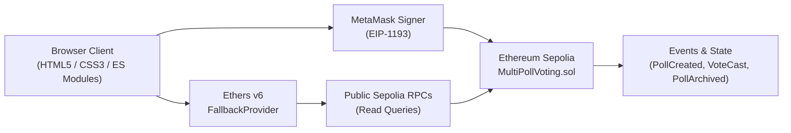

# VOICE: On-chain Voting DApp

[](https://soliditylang.org/)
[](https://hardhat.org/)
[](https://docs.ethers.org/v6/)
[](https://sepolia.etherscan.io/)

VOICE is a decentralized, non-custodial multi-poll voting protocol deployed on the Ethereum Sepolia testnet. Built with pure on-chain state execution and zero centralized database requirements, it enables community members to create custom multi-option polls, cast tamper-evident ballots, participate in cryptographic blind voting, archive completed polls, and verify election results directly against smart contract events.

**Live Demo:** [https://example.invalid](https://example.invalid) *(Update with your production Vercel URL after deployment)*

---

## Screenshots

> *Note: Place your screenshot images inside `docs/screenshots/` as shown below.*

- **Home & Hero 3D Deck:** `docs/screenshots/home.png`
- **Browse Ballots:** `docs/screenshots/polls.png`
- **Single Ballot Voting UI:** `docs/screenshots/poll-detail.png`
- **Create Poll Form:** `docs/screenshots/create.png`
- **Voter Dashboard & Telemetry:** `docs/screenshots/dashboard.png`

---

## Features

### Polls & Administration
- **Multi-Option Ballots:** Create ballots with 2 to 20 custom candidate options and durations up to 30 days (43,200 minutes).
- **Creator Lifecycle Controls:** Poll creators can end active polls early or cancel polls prior to completion.
- **Soft-Delete (Archiving):** Creators can archive ended or cancelled polls to declutter UI listings without breaking historical blockchain immutability.
- **Quick-Fill Templates:** Pre-configured ballot presets for DAO Governance, Community Memes, and Feature Requests on the Create page.

### Voting Logic
- **Strict Double-Voting Prevention:** Enforces non-custodial one-wallet-one-vote rules mapped directly on-chain (`hasVoted[pollId][msg.sender]`).
- **Cryptographic Blind Voting:** Optional blind ballots keep vote tally distributions hidden until the specified poll deadline passes.
- **Real-Time Results:** Automatic tally distribution and percentage calculation on active and closed ballots.
- **Option Shuffle:** Client-side ballot candidate randomization to mitigate ballot order bias.

### Community & Trust Features
- **Voter Activity Dashboard:** Displays personal voting history, created ballots, and soft-delete archive management.
- **Voter Reputation & XP:** Participant level badges calculated from on-chain voter participation and ballot creation.
- **Cryptographic Vote Verifier:** Validates transaction hashes, block confirmations, and voter choices directly on Sepolia Etherscan.
- **Live Network Telemetry:** Live Sepolia block number counter and gas price indicators polled directly from the network.

### UI & Styling
- **Theme Support:** Dark and light mode toggle with persistent local preference.
- **Responsive 3D Card Deck:** Tap-to-flip meme ballot cards with CSS 3D transforms.
- **Fallback-Resilient RPC:** Configured with redundant public Sepolia RPC providers using fallback provider logic.
- **Zero Build Step:** Native vanilla ES modules and semantic HTML/CSS ready for instant static deployment.

---

## How It Works

VOICE operates with zero server-side middleware or centralized databases. The Ethereum Sepolia blockchain acts as the single source of truth for all ballot configurations, options, and vote records.

- **Reads (Zero Wallet Required):** Public users browse ballots, check live tallies, and read telemetry through public Sepolia JSON-RPC endpoints.
- **Writes (MetaMask / EIP-1193):** Creating a poll, casting a vote, canceling, ending early, or archiving triggers a signed transaction through MetaMask.

### Architecture



---

## Smart Contract

- **Contract Name:** `MultiPollVoting`
- **Network:** Ethereum Sepolia (`chainId: 11155111`)
- **Contract Address:** `0x65259cB1AA56eE2145DdB5B7629Aec4C053690A0`
- **Etherscan Link:** [https://sepolia.etherscan.io/address/0x65259cB1AA56eE2145DdB5B7629Aec4C053690A0#code](https://sepolia.etherscan.io/address/0x65259cB1AA56eE2145DdB5B7629Aec4C053690A0#code)
- **Verification Status:** Verified on Sepolia Etherscan (Solidity 0.8.28, 200 Optimizer runs)

### Core Functions
- `createPoll(string _title, string _description, string[] _optionNames, uint256 _durationInMinutes, bool _isBlind)`
- `vote(uint256 _pollId, uint256 _optionId)`
- `cancelPoll(uint256 _pollId)`
- `endPollEarly(uint256 _pollId)`
- `archivePoll(uint256 _pollId)`
- `unarchivePoll(uint256 _pollId)`
- `getPoll(uint256 _pollId)`
- `getOptions(uint256 _pollId)`
- `getPolls(uint256 offset, uint256 limit)`
- `getAllPolls()`
- `getPollCount()`

### Contract Events
- `PollCreated(uint256 indexed pollId, string title, string description, address indexed creator, uint256 endTime, bool isBlind)`
- `VoteCast(uint256 indexed pollId, address indexed voter, uint256 indexed optionId)`
- `PollCancelled(uint256 indexed pollId, address indexed creator)`
- `PollEndedEarly(uint256 indexed pollId, address indexed creator, uint256 endTime)`
- `PollArchived(uint256 indexed pollId, address indexed creator)`
- `PollUnarchived(uint256 indexed pollId, address indexed creator)`

---

## Project Structure

```text
eth-voting-dapp/
├── contracts/
│   └── MultiPollVoting.sol          # Primary voting smart contract
├── scripts/
│   └── deploy.js                    # Sepolia deployment and contract-config sync script
├── test/
│   └── MultiPollVoting.test.js      # Comprehensive contract test suite
├── frontend/
│   ├── vercel.json                  # Vercel deployment and security header config
│   ├── contract-config.js           # Contract address, verified status, ABI, and RPC URLs
│   ├── index.html                   # Landing page with 3D meme deck, stats, and FAQ
│   ├── polls.html                   # Poll browser with filtering, search, and sorting
│   ├── poll.html                    # Single ballot voting page with live results
│   ├── create.html                  # Poll creation form with option builder
│   ├── dashboard.html               # User activity and archived polls manager
│   ├── leaderboard.html             # Participant XP and voter leaderboard
│   ├── verify.html                  # Cryptographic vote verification tool
│   ├── how-it-works.html            # Protocol rules, documentation, and FAQ
│   ├── 404.html                     # Self-contained offline-capable 404 page
│   ├── favicon.svg                  # Isometric cube favicon
│   ├── css/
│   │   ├── base.css                 # CSS variables, typography, reset, grid
│   │   ├── components.css           # Pill navbar, cards, modals, buttons, toasts
│   │   ├── animations.css           # 3D deck, flip transitions, keyframes
│   │   ├── pages.css                # Route-specific page layout styles
│   │   ├── scene3d.css              # 3D floating background scene
│   │   └── transitions.css          # Page view transitions
│   ├── js/
│   │   ├── web3.js                  # Provider and signer management, fallback RPCs
│   │   ├── polls-service.js         # Contract read/write query wrappers
│   │   ├── layout.js                # Navbar, footer, and wallet capsule hydration
│   │   ├── ui.js                    # Toasts, string escaping, helpers
│   │   ├── theme.js                 # Dark/light theme switcher
│   │   ├── xp-service.js            # Voter participation points and badges
│   │   ├── scene3d.js               # Background sticker and telemetry engine
│   │   ├── memes.js                 # Meme manifest loader
│   │   └── transitions.js           # View transitions handler
│   └── assets/
│       ├── stickers/                # Inline SVG sticker graphics
│       └── memes/                   # Meme images, mp4 clips, and manifest
├── hardhat.config.js                # Hardhat network and compiler configuration
├── package.json                     # Project scripts and dependencies
├── .env.example                     # Environment variable template (keys omitted)
├── .gitignore                       # Ignored build, secret, and node files
├── LICENSE                          # MIT License
└── README.md                        # Documentation
```

---

## Run Locally

### Prerequisites
- [Node.js](https://nodejs.org/) (v18 or higher)
- [MetaMask](https://metamask.io/) browser extension configured for the Ethereum Sepolia network
- Sepolia testnet ETH from a faucet (e.g., [Google Cloud Web3 Faucet](https://cloud.google.com/application/web3/faucet/ethereum/sepolia) or [Alchemy Faucet](https://www.alchemy.com/faucets/ethereum-sepolia))

### Steps

1. **Clone and Install Dependencies:**
   ```bash
   git clone https://github.com/Shivendra07-run/voice-voting-dapp.git
   cd voice-voting-dapp
   npm install
   ```

2. **Run Smart Contract Unit Tests:**
   ```bash
   npx hardhat test
   ```

3. **Start the Local Development Server:**
   ```bash
   npx serve frontend -l 3000
   ```

4. **Open in Browser:**
   Navigate to [http://localhost:3000](http://localhost:3000).

---

## Deploying the Smart Contract

1. **Configure Environment Variables:**
   Copy `.env.example` to `.env`:
   ```bash
   cp .env.example .env
   ```
   Add your Sepolia credentials to `.env`:
   ```env
   SEPOLIA_RPC_URL=https://eth-sepolia.g.alchemy.com/v2/YOUR_API_KEY
   PRIVATE_KEY=your_wallet_private_key_without_0x
   ETHERSCAN_API_KEY=your_etherscan_api_key
   ```
   *(Never commit `.env` to git. Ensure it remains in `.gitignore` at all times.)*

2. **Deploy to Sepolia:**
   ```bash
   npx hardhat run scripts/deploy.js --network sepolia
   ```
   *The deployment script automatically compiles the contract, deploys it to Sepolia, and writes the address and ABI to `frontend/contract-config.js`.*

3. **Verify Source Code on Etherscan:**
   ```bash
   npx hardhat verify --network sepolia <NEW_CONTRACT_ADDRESS>
   ```

---

## Deploying the Frontend on Vercel

1. Log in to [Vercel](https://vercel.com/) and click **Add New > Project**.
2. Import your GitHub repository: `Shivendra07-run/voice-voting-dapp`.
3. In the project setup screen, configure the following settings:
   - **Root Directory:** Click Edit and select `frontend`
   - **Framework Preset:** `Other`
   - **Build Command:** Leave empty / disabled (no build step needed)
   - **Output Directory:** Leave empty / default
   - **Install Command:** Leave empty / default
4. Click **Deploy**. Vercel will serve `frontend/` as the static website root using `frontend/vercel.json` routing.

---

## Updating After Changes

When updating smart contracts or frontend files:

1. If smart contracts are modified or redeployed:
   - Update `frontend/contract-config.js` with the new address and ABI.
2. Commit and push your changes to GitHub:
   ```bash
   git add -A
   git commit -m "feat: your change summary"
   git push origin main
   ```
3. Vercel automatically detects the push and redeploys the site.

---

## Security Notes

- **Never Commit Secrets:** `.env`, private keys, and API credentials must never be committed to git.
- **Throwaway Accounts:** Always use a dedicated test development wallet with zero mainnet assets when running deploy scripts.
- **Public Data in Frontend:** The `frontend/` folder contains only public blockchain configurations (contract address, public ABI, and public RPC endpoints).

---

## Known Limitations

- **Sybil Resistance:** One-wallet-one-vote does not prevent an individual user from voting multiple times using different wallet addresses. Production DAO systems typically integrate token-weighted voting or proof-of-humanity checks.
- **Public On-Chain Records:** All votes, choices, and voter addresses are stored publicly on the Ethereum blockchain.
- **Soft-Delete Scope:** Archiving a poll hides it in the default frontend listing, but all historical ballot data remains permanently accessible on the blockchain.
- **Testnet Deployment:** Deployed on Ethereum Sepolia for evaluation purposes; contract code is unaudited.

---

## Credits & Attribution

- **Meme Artwork:** Meme art belongs to its original creators and is used strictly for non-commercial demo purposes.
- **Libraries Used:**
  - [Hardhat](https://hardhat.org/) & `@nomicfoundation/hardhat-toolbox`
  - [ethers.js v6](https://docs.ethers.org/v6/)
  - [canvas-confetti](https://www.npmjs.com/package/canvas-confetti)

---

## License

This project is licensed under the [MIT License](LICENSE).

*Notice: Media assets located under `frontend/assets/memes/` are third-party artwork used for demonstration purposes and are not covered by the MIT license.*
